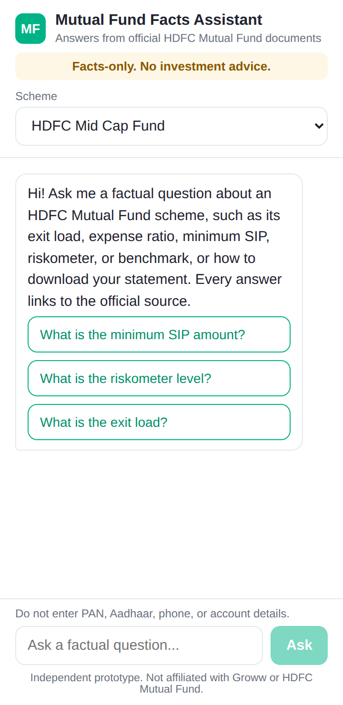
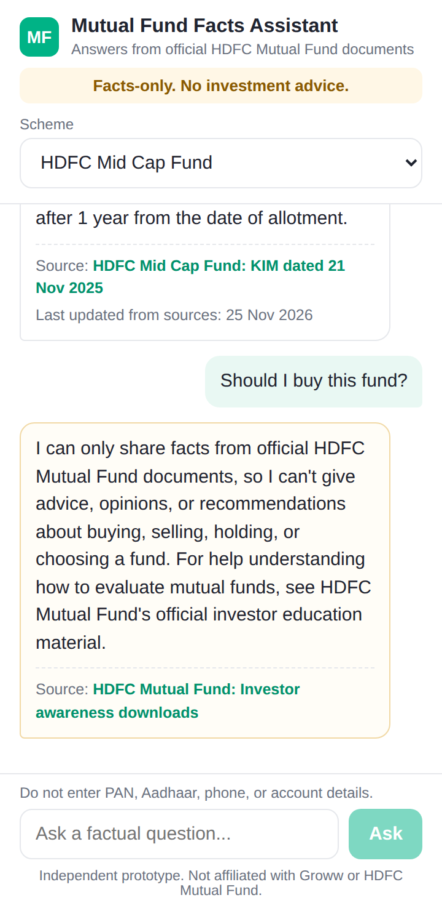

# Mutual Fund Facts Assistant (independent prototype)

A facts-only chat assistant for three HDFC Mutual Fund schemes, designed as a help feature for a mutual fund app. It answers a narrow set of factual questions from official HDFC Mutual Fund documents. Every answer carries exactly one official source link and the date the source was collected. In every other case it refuses or says it does not know.

> **Facts-only. No investment advice.**
> Independent prototype. Not affiliated with Groww or HDFC Mutual Fund.

- **Live app:** https://groww-mf-facts-assistant.vercel.app
- **Test set and results:** [`eval/questions.csv`](eval/questions.csv), [`eval/results.md`](eval/results.md), [`eval/results.csv`](eval/results.csv)
- **Sources:** [`sources.csv`](sources.csv) (19 official HDFC Mutual Fund URLs)
- **Sample answers:** [`docs/sample-qa.md`](docs/sample-qa.md)
- **Disclaimer text:** [`config/disclaimer.md`](config/disclaimer.md)
- **Decision log:** [`docs/decision-log.md`](docs/decision-log.md)
- **Demo run on the live app:** [`docs/demo-run.md`](docs/demo-run.md)
- **Evaluation history and fixes:** [`eval/history.md`](eval/history.md)

<p> </p>

## What it does

| Question type | Reply |
| --- | --- |
| A factual question about HDFC Flexi Cap Fund, HDFC Mid Cap Fund or HDFC Balanced Advantage Fund (exit load, expense ratio, minimum SIP, riskometer, benchmark) or about downloading a statement | Up to three sentences from the official text, one source link, and "Last updated from sources: date" |
| Advice or opinion ("Should I buy?", "Is this expense ratio too high?", "Which is better?") | A polite refusal with a link to HDFC Mutual Fund's investor education downloads |
| Returns or performance | No numbers. A link to the scheme's official Fund Facts document |
| A message containing PAN, Aadhaar, a phone number, an email address, an OTP or an account number | Blocked before anything else runs. Nothing is searched, sent to a model, stored or logged |
| Something the sources do not cover | "Not found in official sources" and a link to the scheme page. It never guesses |

## How it works

The assistant uses retrieval-augmented generation (RAG). The system first finds the right pieces of official text, and then a language model writes a short answer from those pieces only.

```
Ingestion (runs once, on a machine with internet; never on Vercel)
  sources.csv -> fetch each URL -> save raw copy (data/raw)
  -> extract main text (data/text) -> split by section heading
  -> label each piece with scheme, plan, document and section
  -> embed (gemini-embedding-2, 768 dimensions; 725 pieces) -> Neon Postgres + pgvector

Question path (POST /api/chat on Vercel)
  1. personal-data check  -> privacy reply
  2. advice check         -> refusal + investor education link
  3. returns check        -> no numbers + Fund Facts link
  4. follow-up rewrite    -> complete question naming the scheme
  5. search (selected scheme + general documents, top 5, minimum score)
                          -> nothing good enough: "not found" + scheme page link
  6. model answers from the retrieved pieces only (gemini-3.5-flash-lite, falling back to gemini-3.1-flash-lite; JSON output)
  7. code attaches one link and the collection date from data/manifest.json
```

The model never writes a link or a date. It returns the number of the piece it used, and code looks up that piece's document in the manifest.

## Design choices

Each choice exists to stop a specific failure.

| Choice | Decision | Failure it prevents |
| --- | --- | --- |
| Where ingestion runs | A script (`npm run ingest`), never a Vercel function | Short-lived functions timing out on large PDFs |
| Source of truth | `sources.csv`, turned into `data/manifest.json` with each collection date | Links and dates drifting from the text they belong to |
| Saved copies | Every fetched file is kept in `data/raw`, and its extracted text in `data/text` | A fund house replacing a document and silently changing results |
| Fund pages | Facts are read from the page's structured data (its Overview block only). Menus, footer, the returns ticker, performance tables and holdings are never read | Return figures of other funds entering the store |
| PDFs | `pdftotext -layout`; pieces are split on section headings and on line boundaries only | A number in a table row being separated from its label |
| Labelling | Every piece starts with "Scheme | Plan | Document | Section" | A piece giving an exit load without saying which fund it belongs to |
| Search filter | Only the selected scheme's documents plus the three general documents | A number from another fund entering the answer |
| Ranking | Meaning-based search, fused with keyword search; fund pages, scheme summaries and KIMs are ranked above Fund Facts PDFs | Fund Facts PDFs print labels and values in separate blocks |
| Match threshold | Top 5 pieces; nothing is returned below a minimum similarity | The model guessing from weak text |
| Order of checks | Personal data and advice are checked before any search | Personal data reaching the model or logs |
| Plans | When no plan is named and the fact differs by plan, both Direct and Regular figures are given | A user reading the wrong plan's expense ratio |
| Citation | Code attaches the link and date | An invented or broken link |
| Chat history | Kept in the browser only; the server receives just the previous question for follow-ups | The server holding anything about a visitor |
| Abuse | 20 questions per visitor per hour (salted IP hash, no raw IP stored); query embeddings cached by hash | A public link running up model costs |

### Alternative considered: a facts table

For a real product with only three schemes, a hand-typed facts table (one row per scheme, one column per fact) would be accurate, cheap and simple. It was rejected for this prototype because it shows no retrieval, which is a graded skill here, and it fails on any question that has no planned column. Pasting whole documents into the prompt was also rejected: scheme documents run past 100 pages each, which makes it slow, costly and hard to cite precisely.

## Scope

- **In:** HDFC Mutual Fund only; HDFC Flexi Cap Fund, HDFC Mid Cap Fund and HDFC Balanced Advantage Fund; expense ratio, exit load, minimum SIP, riskometer, benchmark, and how to download statements; the 19 official documents in `sources.csv`.
- **Cut:** advice, recommendations and portfolio reviews (advice needs SEBI registration); computing or comparing returns; other fund houses and schemes; buying a fund or starting a SIP; login and accounts; languages other than English.

## Evaluation

The 29-question test set was written before tuning, and questions are never edited to make them pass. It covers 15 factual questions, 5 advice or returns questions, 3 questions the sources cannot answer, 2 personal-data messages, 2 follow-ups and 2 loose scheme names. Every failure is sorted as either "search found the wrong pieces" or "the model misread the right pieces".

Final run against the live URL (run 2, 25 Nov 2026):

| Gate | Target | Result |
| --- | --- | --- |
| Retrieval hit rate (expected source in top 3) | 90% or higher | 100% (19 of 19) |
| Fact accuracy | 90% or higher | 100% (19 of 19) |
| Citation correctness | 100% | 100% (19 of 19) |
| Refusal accuracy | 100% | 100% (5 of 5) |
| Wrong refusals | 5% or lower | 0% |
| Honest not-found | 100% | 100% (3 of 3) |
| Personal data stored or logged | Zero | Zero |

Run 1 scored 84.2% on fact accuracy. The three failures, their causes and the fixes are in [`eval/history.md`](eval/history.md).

**Sanity check against the official pages (25 Nov 2026).** The store reproduces every value given in the brief. HDFC Mid Cap Fund, Regular plan: exit load 1.00% within 1 year and nil after; TER 1.30%; minimum SIP Rs 100; riskometer Very High; benchmark NIFTY Midcap 150 Index (TRI). HDFC Flexi Cap Fund, Direct plan: exit load 1.00% within 1 year and nil after; TER 0.74%; minimum SIP Rs 100; riskometer Very High; benchmark NIFTY 500 TRI.

Run it yourself against a running app:

```bash
npm run eval:retrieval            # Stage 2 gate: is the expected source in the top 3?
npm run eval -- --base http://localhost:3000
```

## Known limits

- **Free-tier model quotas.** The Gemini free tier allows 1,000 embedding requests per day per model. Ingestion used about 725, and each new question uses one more (repeated questions are served from a cache). Heavy traffic will see "Something went wrong" until the quota resets. Enabling billing on the Google AI Studio project removes this limit for a few cents.
- **Answer model availability.** `gemini-3.1-flash-lite` returned "high demand" errors during the build, so `gemini-3.5-flash-lite` is the main model and 3.1 is the fallback.
- **Investor FAQs page.** The FAQ URL in `sources.csv` only lists FAQ categories. The answers live on sub-pages that are not in the corpus, so most general FAQ questions get "not found".
- **Older Mid Cap KIM and SID.** `sources.csv` lists the HDFC Mid Cap Fund KIM and SID dated 21 Nov 2025. The official fund page now links copies dated Nov 2026. They were not swapped in, because the corpus is fixed to `sources.csv`. The tested facts match the fund page.
- **Lock-in.** No source states a lock-in period for these schemes (the SIDs only say "lock-in period, if any"), so the assistant replies "not found".
- **Commission.** The sources say no commission is paid from the Direct Plan, but they give no commission rate, so that answer is partial by design.
- **Citation choice.** Exit-load answers sometimes cite the KIM instead of the fund page. Both documents hold the fact.
- **Rule-based checks.** Advice and personal-data detection use patterns. Unusual phrasing can slip past the advice rules (the answer prompt is a second check), and any number of 9 or more digits is blocked as a possible account number.
- **Shared networks.** The limit of 20 questions per hour is per IP address, so people behind one office or campus IP share it.
- **Freshness.** Facts are a snapshot collected on 25 Nov 2026. Ingestion depends on the fund pages keeping their current structure and on the site accepting the download requests; re-run it monthly.
- **Follow-ups.** Only the previous question is used to complete a follow-up.
- **Fund Facts PDFs.** Their layout separates labels from values, so they are ranked last and used mainly as the returns link.

## Setup

Requirements: Node 20+, `pdftotext` (poppler-utils) and `curl` for ingestion, a Neon Postgres database, and a Gemini API key.

```bash
npm install
cp .env.example .env.local     # then fill in the values; never commit this file
npm run ingest                 # fetch, split, embed and store all 19 sources
npm run dev                    # http://localhost:3000
```

Environment variables (names only; values live in `.env.local` and in Vercel project settings):

| Name | Purpose |
| --- | --- |
| `DATABASE_URL` | Neon connection string |
| `GEMINI_API_KEY` | Gemini API key for embeddings and answers |
| `RATE_SALT` | Salt for hashing visitor IPs in the rate limiter |
| `EVAL_TOKEN` | Lets the evaluation script bypass the rate limit and see debug output |
| `EMBED_MODEL`, `CHAT_MODEL` | Optional model overrides (defaults: `gemini-embedding-2`, `gemini-3.5-flash-lite`; fallback `CHAT_MODEL_FALLBACK=gemini-3.1-flash-lite`) |

The model instructions are in [`config/prompts/`](config/prompts) and the fixed replies are in [`config/replies.json`](config/replies.json); both can be edited without touching code.

Re-run `npm run ingest` monthly so expense ratios and dates stay current.

## Disclaimer

This assistant answers factual questions about three HDFC Mutual Fund schemes using only official HDFC Mutual Fund documents. It does not give investment advice, recommendations or opinions, and it does not state, calculate or compare returns. Facts such as expense ratios change over time, so every answer shows the date its source was collected and links to the official page. Check the official document before acting on any figure. This is an independent portfolio prototype. It is not affiliated with, endorsed by, or connected to Groww or HDFC Asset Management Company Limited.
